# Vexa Store — Sistema de E-commerce

**Aluno:** Ronald Machado  
**Professor:** Anderson Soares  
**Disciplina:** Projeto Banco de Dados  
**Atividade:** 3ª Avaliação — 2026

## Sobre o projeto

A Vexa Store é um sistema de e-commerce desenvolvido em Python com Flask, utilizando o conceito de Banco de Dados Poliglota. O projeto integra Supabase, MongoDB Atlas e Redis Cloud, distribuindo as responsabilidades de armazenamento de acordo com as necessidades de cada funcionalidade.

O sistema possui catálogo de produtos, painel administrativo, carrinho de compras, cadastro de clientes e integração com o WhatsApp para preparação de pedidos.

A interface foi desenvolvida com HTML, CSS e JavaScript, seguindo uma identidade visual em azul e branco. O logotipo da Vexa foi criado manualmente no Canva.

<p align="center">
  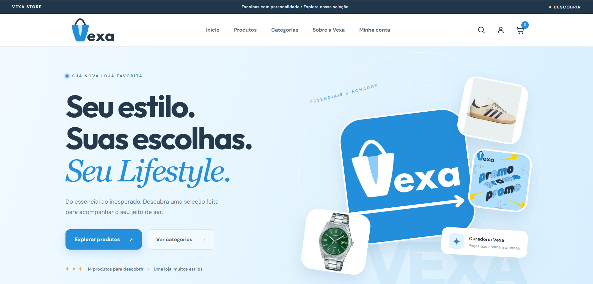
</p>

## Tecnologias utilizadas

| Tecnologia | Utilização |
|---|---|
| Python e Flask | Desenvolvimento do backend e das rotas da aplicação |
| HTML, CSS e JavaScript | Interface web e interatividade |
| Supabase Auth | Autenticação do administrador e dos clientes |
| PostgreSQL (Supabase) | Armazenamento dos perfis e pedidos preparados |
| MongoDB Atlas | Cadastro e gerenciamento dos produtos |
| Redis Cloud | Cache de visualizações recentes e sessões temporárias |
| PyMongo e redis-py | Integração com MongoDB e Redis |
| Requests, Pillow e python-dotenv | Requisições, tratamento de imagens e configurações |
| WhatsApp | Redirecionamento com mensagem do pedido |
| Canva | Criação manual do logotipo |

## Organização dos bancos de dados

O projeto utiliza três bancos com responsabilidades diferentes, evitando concentrar todas as informações em uma única tecnologia.

**Supabase (PostgreSQL)**

Utilizado para autenticação do administrador e dos clientes, além do armazenamento de perfis e pedidos preparados.

A autenticação é realizada pelo Supabase Auth, enquanto o PostgreSQL armazena as informações nas tabelas:

- `auth.users`: usuários autenticados, gerenciados pelo Supabase.
- `vexa_clientes`: identificação e nome dos clientes.
- `vexa_pedidos`: produtos, valores, status e data dos pedidos preparados.

As tabelas possuem relacionamentos com os usuários autenticados e políticas de segurança Row Level Security (RLS), restringindo o acesso aos dados de cada cliente.

O script SQL utilizado está disponível no arquivo [SUPABASE_CLIENTES.sql](SUPABASE_CLIENTES.sql).

**MongoDB Atlas**

Responsável pelo armazenamento do catálogo no banco `vexa_store`, coleção `produtos`.

Os documentos armazenam informações como código (SKU), nome, categoria, descrição, preço, imagem e destaque. A estrutura permite cadastrar produtos de diferentes categorias e realizar operações de criação, consulta, edição e exclusão pelo painel administrativo.

**Redis Cloud**

Utilizado para armazenar temporariamente os produtos visualizados recentemente pelos visitantes da loja. Também é utilizado no gerenciamento de sessões de clientes, permitindo acesso rápido a informações temporárias.

O Redis complementa os bancos de dados principais, sem substituir o armazenamento permanente dos produtos e pedidos.

## Funcionalidades do sistema

### Loja e carrinho de compras

A loja permite visualizar os produtos disponíveis, pesquisar itens pelo nome, navegar por categorias e consultar informações detalhadas dos produtos.

O carrinho permite adicionar e remover itens, alterar quantidades e calcular automaticamente o valor total.

Na finalização, o sistema gera uma mensagem contendo os produtos selecionados, as quantidades e o total, redirecionando o usuário para o WhatsApp. Não há processamento de pagamentos diretamente na aplicação.

<p align="center">
  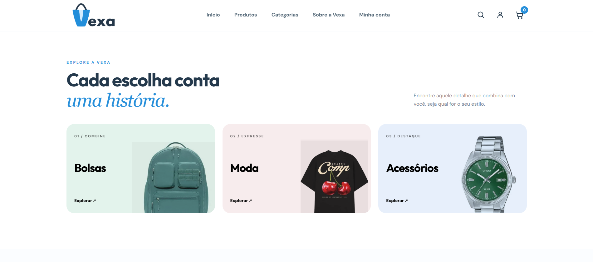
</p>

<p align="center">
  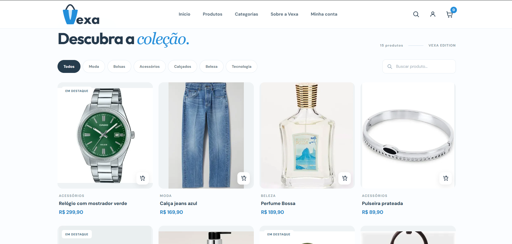
</p>

<p align="center">
  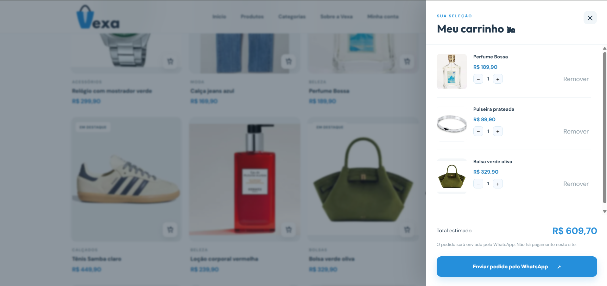
</p>

### Cadastro e acesso dos clientes

Foi implementada uma área de clientes integrada ao Supabase Auth. O usuário pode criar uma conta, realizar login, atualizar o nome cadastrado e consultar o histórico dos pedidos preparados.

Os registros dos pedidos são armazenados no PostgreSQL, permitindo associá-los ao cliente autenticado.

<p align="center">
  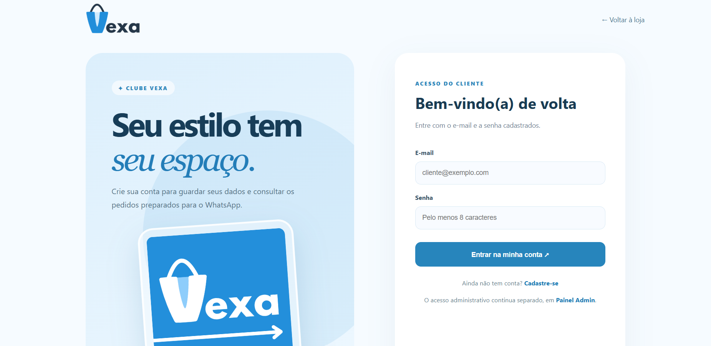
</p>

<p align="center">
  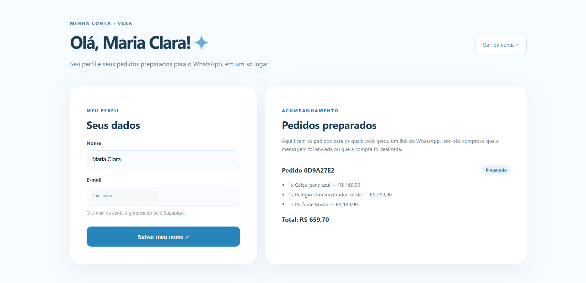
</p>

### Painel administrativo

O administrador possui uma área restrita, com autenticação realizada pelo Supabase e verificação de acesso autorizado.

No painel, é possível visualizar informações do catálogo e gerenciar os produtos armazenados no MongoDB.

O formulário de cadastro permite informar nome, código, categoria, descrição, preço, imagem e destaque. Também são disponibilizadas as opções de edição e exclusão.

Após cadastrar um produto, ele pode ser consultado na listagem do administrador e no catálogo público da loja.

<p align="center">
  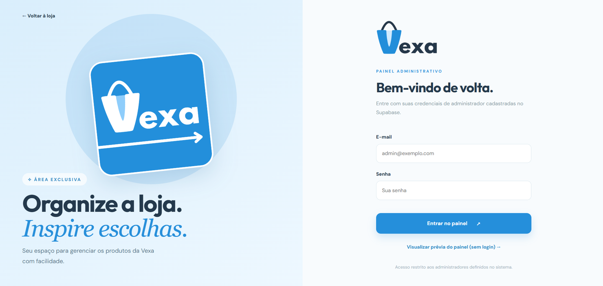
</p>

<p align="center">
  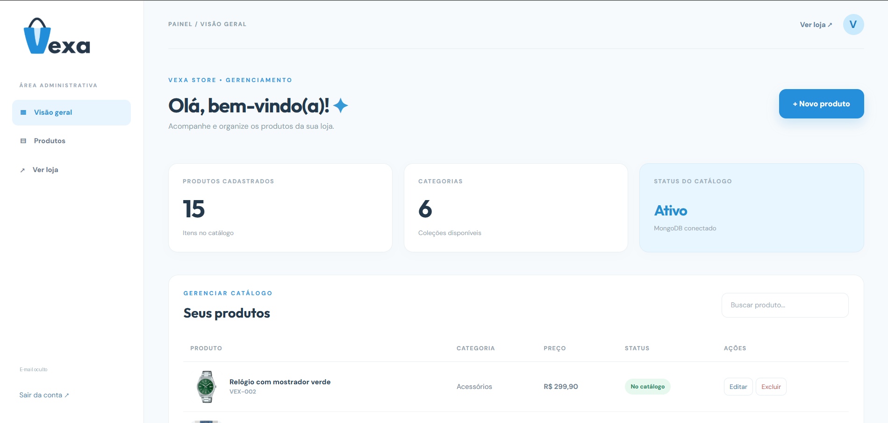
</p>

<p align="center">
  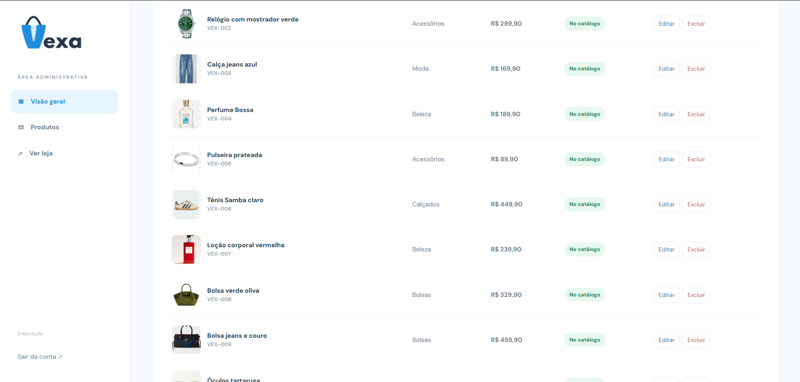
</p>

<p align="center">
  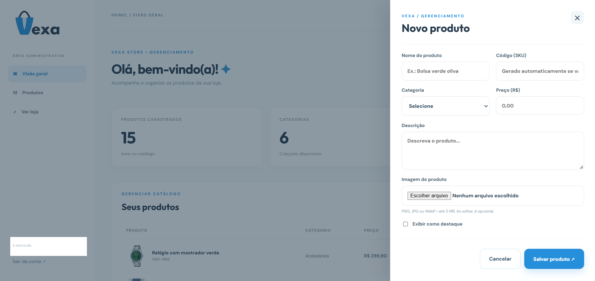
</p>

<p align="center">
  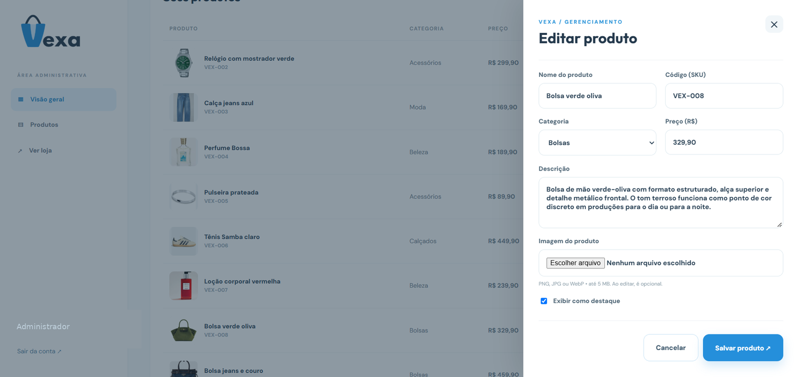
</p>

## Estrutura do projeto

```text
vexa-sistema/
├── app.py
├── clientes.py
├── seed.py
├── verificar_conexoes.py
├── verificar_historico.py
├── testes_basicos.py
├── SUPABASE_CLIENTES.sql
├── requirements.txt
├── .env.example
├── .gitignore
├── iniciar_windows.bat
├── templates/
│   ├── index.html
│   ├── login.html
│   ├── admin.html
│   ├── cliente_auth.html
│   └── cliente_conta.html
├── static/
│   ├── css/
│   ├── js/
│   ├── img/
│   └── uploads/
├── data/
│   └── produtos_demo.json
├── docs/
│   └── imagens/
└── README.md
```

O `app.py` contém as rotas e funcionalidades principais da aplicação Flask. O `clientes.py` reúne os recursos de autenticação e gerenciamento das contas dos clientes.

O `seed.py` realiza a carga inicial dos produtos no MongoDB. Os arquivos `verificar_conexoes.py` e `verificar_historico.py` permitem verificar os serviços e consultar os dados temporários do Redis.

Os arquivos HTML estão organizados em `templates`, enquanto os estilos, scripts e imagens utilizados pela interface estão em `static`.

## Configuração e execução

O sistema foi desenvolvido em ambiente Windows, utilizando Python 3.11 e Visual Studio Code.

**1. Instalar as dependências**

Abra o terminal na pasta do projeto e execute:

```powershell
python -m venv .venv
.\.venv\Scripts\python.exe -m pip install -r requirements.txt
```

**2. Configurar as conexões**

Crie um arquivo `.env` com base no `.env.example` e informe:

- URL de conexão do MongoDB Atlas.
- URL de conexão do Redis Cloud.
- URL e chave pública do Supabase.
- E-mail autorizado para administração.
- Número de WhatsApp da loja.
- Chave secreta do Flask.

Para utilizar os bancos reais, configure `DEMO_MODE=false`.

No Supabase, execute o arquivo `SUPABASE_CLIENTES.sql` pelo SQL Editor para criar as tabelas e as políticas de segurança, caso ainda não estejam configuradas.

Para carregar os produtos iniciais no MongoDB, se necessário:

```powershell
.\.venv\Scripts\python.exe seed.py
```

**3. Verificar as conexões dos bancos**

```powershell
.\.venv\Scripts\python.exe verificar_conexoes.py
```

Durante os testes realizados, os três serviços responderam corretamente:

```text
[OK] MongoDB - Conectado
[OK] Redis - Conectado
[OK] Supabase Auth - Conectado

SUCESSO: Os três serviços responderam!
Modo integrado ativado.
```

<p align="center">
  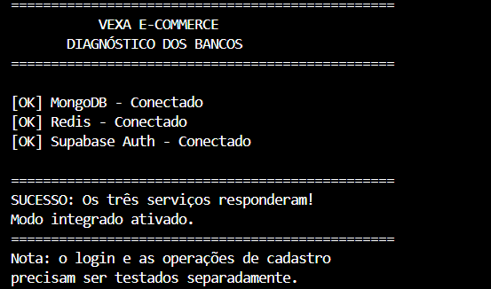
</p>

**4. Iniciar o sistema**

```powershell
.\.venv\Scripts\python.exe -c "from app import app; app.run(host='127.0.0.1', port=5001, debug=False)"
```

Após iniciar o servidor, acesse:

| Página | Endereço |
|---|---|
| Loja | http://127.0.0.1:5001 |
| Administração | http://127.0.0.1:5001/admin/login |
| Cadastro de clientes | http://127.0.0.1:5001/cliente/cadastro |
| Login de clientes | http://127.0.0.1:5001/cliente/login |

O arquivo `.env` contém credenciais privadas e não deve ser publicado no GitHub.

## Vídeo de demonstração

**[Assistir ao vídeo de demonstração da Vexa](https://drive.google.com/file/d/10MB6k9dIEQ6-mY4GZRyoOa6r_H3iUkx4/view?usp=sharing)**

O vídeo apresenta a execução do sistema, incluindo o login do administrador, o cadastro de um produto com atualização no catálogo e a simulação de compra com redirecionamento e mensagem formatada para o WhatsApp.

---

**Ronald Machado — Projeto Banco de Dados — Professor Anderson Soares — 2026**
